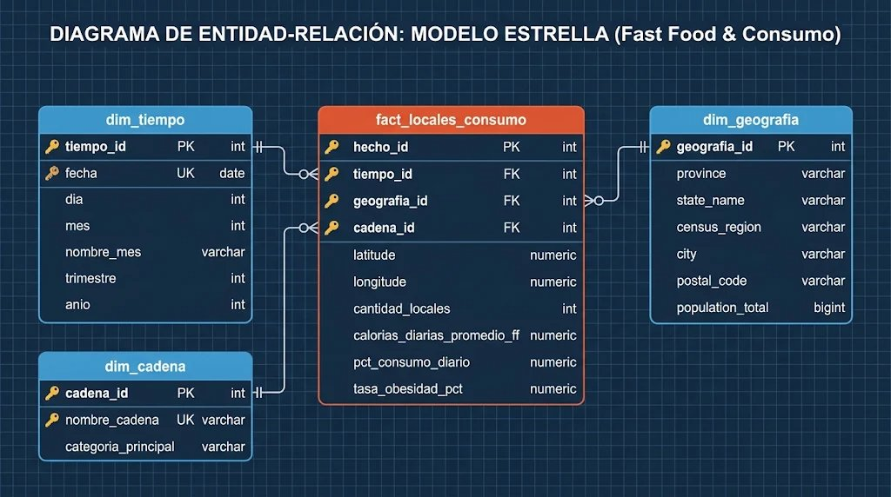

# Trabajo Integrador AE4: Gestión Avanzada de Bases de Datos (2026)

## Integración de datos y analítica: oferta comercial de comida rápida, patrones de consumo calórico y prevalencia de obesidad adulta en Estados Unidos

- Carrera: Ingeniería en Sistemas de Información
- Materia: Gestión Avanzada de Bases de Datos
- Profesores: Gabriel del Rosario, Portel Marcos, Fernández Victoria
- Fecha de entrega: 16/11/2026
- Modalidad: Trabajo grupal integrador
- Base de datos implementada: PostgreSQL (`dw_fastfood`)
- Herramienta de visualización: Microsoft Power BI Desktop

## Índice de contenidos

1. **Objetivo del proyecto, contexto y definición del negocio:** 1.1 Objetivo general, hilo conductor y justificación de la arquitectura técnica | 1.2 Contexto del proceso analizado y problemática comercial y sanitaria | 1.3 Formulación y fundamentación de las cuatro preguntas de negocio | 1.4 Definición matemática y operativa de los tres indicadores clave (KPIs) | 1.5 Criterios metodológicos y supuestos de trabajo | 1.6 Alcance analítico y limitaciones de las fuentes seleccionadas.
2. **Relevamiento y descripción de las fuentes de datos:** 2.1 Fuente 1 (real y externa): padrón georreferenciado de locales (`FastFoodRestaurants.csv`) | 2.2 Fuente 2 (construida por el grupo): demografía, consumo calórico y obesidad estatal (`us_states_consumption_demographics.csv`) | 2.3 Complementariedad de las fuentes y necesidad del cruce relacional.
3. **Proceso ETL con Python y pandas:** 3.1 Ingestión independiente y reparación estructural del archivo de locales | 3.2 Limpieza y tratamiento de anomalías en la Fuente 1 | 3.3 Limpieza, desduplicación e imputación estadística en la Fuente 2 | 3.4 Transformaciones previas y categorización de cadenas gastronómicas | 3.5 Estrategia de cruce (`merge`) y validaciones de integridad posteriores.
4. **Diseño e implementación del Data Warehouse en PostgreSQL:** 4.1 Modelado dimensional en esquema estrella (`Star Schema`) | 4.2 Granularidad de la tabla de hechos y aditividad de las métricas | 4.3 Justificación de las dimensiones de negocio y de la dimensión temporal | 4.4 Implementación física, integridad referencial y estrategia de indexación.
5. **Diccionario de datos del Data Warehouse (`dw_fastfood`):** 5.1 Tabla `dim_tiempo` (`366` filas) | 5.2 Tabla `dim_geografia` (`5.189` filas) | 5.3 Tabla `dim_cadena` (`466` filas) | 5.4 Tabla de hechos `fact_locales_consumo` (`9.904` filas).
6. **Construcción del dashboard interactivo en Power BI:** 6.1 Modelo relacional, preparación en Power Query y categorización geográfica | 6.2 Diseño de medidas DAX para indicadores ponderados y cuotas de mercado | 6.3 Disposición visual, tarjetas de KPIs, filtros interactivos y respuesta a las cuatro preguntas.
7. **Resolución analítica de las preguntas de negocio, hallazgos y recomendaciones:** 7.1 Evaluación general de los tres KPIs | 7.2 Resolución de la Pregunta 1 (densidad estatal `DLFF`) | 7.3 Resolución de la Pregunta 2 (relación regional con consumo y obesidad) | 7.4 Resolución de la Pregunta 3 (cuota de mercado `PMC` por región) | 7.5 Resolución de la Pregunta 4 (umbral de `900 kcal` en 2024) | 7.6 Recomendaciones para la toma de decisiones comerciales y de salud pública.
8. **Limitaciones metodológicas y técnicas del trabajo.**

SALTO_DE_PAGINA

## 1. Objetivo del proyecto, contexto y definición del negocio

### 1.1 Objetivo general, hilo conductor y justificación de la arquitectura técnica

El objetivo de este trabajo integrador es resolver un caso completo de analítica de datos articulando las tres etapas prácticas desarrolladas durante la cursada de Gestión Avanzada de Bases de Datos: la ingestión, limpieza, transformación y cruce de fuentes heterogéneas con Python y `pandas` (proceso ETL), la construcción de un Data Warehouse dimensional en PostgreSQL y la visualización interactiva de resultados en Power BI.

El diseño del proyecto sigue un hilo conductor verificable desde el planteo inicial hasta el tablero final. Cada pregunta de negocio exige cruzar el padrón de locales con variables demográficas y epidemiológicas, define qué reglas de limpieza se aplican en el ETL, justifica una dimensión o métrica en el esquema estrella y se traduce en un gráfico específico del dashboard.

La selección de las herramientas técnicas responde al volumen y la estructura de los datos trabajados. En la capa de extracción y transformación se utilizó Python con `pandas` porque el archivo original de sucursales presentaba problemas de estructura CSV (20 filas con comas internas dentro de la dirección que desplazaban las columnas siguientes), 51 registros con errores de signo en la longitud geográfica y 540 variantes ortográficas para nombrar a 466 cadenas reales. Automatizar este proceso mediante scripts permitió reparar el archivo sin editar a mano los datos de origen, unificar nombres comerciales con expresiones regulares, imputar valores faltantes según la media de cada región censal y verificar la relación muchos a uno (`many_to_one`) en el `merge`.

Para el almacenamiento analítico se implementó un Data Warehouse en PostgreSQL bajo un modelo dimensional en esquema estrella (`dw_fastfood`). Guardar el resultado del cruce en una única tabla plana habría repetido el nombre del estado, la región censal y la población estatal en cada una de las 9.904 filas de sucursales. Al separar tres dimensiones (`dim_tiempo`, `dim_geografia` y `dim_cadena`) y una tabla central de hechos (`fact_locales_consumo`), el motor relacional garantiza la integridad referencial mediante claves foráneas y resuelve las consultas analíticas mediante agregaciones y expresiones de tabla comunes (`CTEs`).

En la capa de visualización se eligió Microsoft Power BI Desktop. Dado que el modelo combina una métrica aditiva a nivel de local (`cantidad_locales = 1`) con indicadores demográficos y sanitarios que tienen nivel estatal (`population_total`, `pct_consumo_diario`, `tasa_obesidad_pct`), un promedio simple sobre las filas de la tabla de hechos daría un resultado incorrecto. El lenguaje DAX permite iterar sobre la lista única de estados activos en cada filtro (`SUMX(VALUES(dim_geografia[province]), ...)`), calculando de forma exacta la densidad cada 100.000 habitantes y las tasas ponderadas por población.

**Tabla 1. Matriz de trazabilidad del hilo conductor del proyecto**

| Eje analítico | Fuentes de origen | Regla clave en el ETL | Tablas del DW | Consulta SQL | Visual en Power BI | Decisión que habilita |
| :--- | :--- | :--- | :--- | :--- | :--- | :--- |
| **Pregunta 1** (Top 5 estados por densidad `DLFF` vs. media nacional) | Fuente 1 (`province`, locales) y Fuente 2 (`population_total`) | Desduplicación de locales, ajuste de `"Co Spgs"` a `"CO"` y `merge` por `province` | `fact_locales_consumo` y `dim_geografia` | Consulta 1 (`CTE` estatal y `CROSS JOIN` media nacional) | Barras horizontales con línea de referencia en `2,96` | Distinguir mercados estatales saturados de plazas con margen de apertura |
| **Pregunta 2** (Densidad regional vs. consumo diario y obesidad) | Fuente 1 (locales) y Fuente 2 (`census_region`, `%` consumo y `%` obesidad) | Imputación de nulos en `ND` y `DE` por media regional y cruce `N:1` | `fact_locales_consumo` y `dim_geografia` | Consulta 2 (agregación regional ponderada por población) | Gráfico de dispersión y burbujas por estado y región | Definir regiones prioritarias para prevención nutricional y cambios de menú |
| **Pregunta 3** (Cuota de mercado `PMC` de cadenas líderes por región) | Fuente 1 (`name`, `province`) y Fuente 2 (`census_region`) | Unificación alfanumérica de 540 a 466 marcas y clasificación en 8 rubros | `fact_locales_consumo`, `dim_cadena` y `dim_geografia` | Consulta 3 (`CTE` de top 8 cadenas y cuota por región) | Columnas 100 % apiladas por región censal | Planificar la expansión competitiva de franquicias según su peso regional |
| **Pregunta 4** (Regiones con ingesta `> 900 kcal` en cortes de 2024) | Fuente 1 (locales) y Fuente 2 (`avg_daily_ff_calories`, `reference_date`) | Conversión de fecha de corte trimestral 2024 y enlace con calendario | `fact_locales_consumo`, `dim_geografia` y `dim_tiempo` | Consulta 4 (`JOIN` temporal con filtro `HAVING AVG > 900`) | Columnas (locales) y línea (`kcal`) con umbral en `900` | Focalizar medidas de etiquetado calórico en las regiones críticas |

### 1.2 Contexto del proceso analizado y problemática comercial y sanitaria

El estudio analiza la distribución territorial de la oferta de restaurantes de comida rápida (*fast food*) en Estados Unidos y su relación con los hábitos de consumo diario, la ingesta calórica y la prevalencia de obesidad adulta. Para ello se cruza la ubicación de 9.904 sucursales pertenecientes a 466 cadenas con los datos demográficos del *U.S. Census Bureau* y las estadísticas epidemiológicas estatales del *Centers for Disease Control and Prevention* (`CDC / BRFSS / NHANES`) relevadas durante los cuatro trimestres de 2024 en las 51 jurisdicciones estadounidenses (los 50 estados y Washington D.C.).

Evaluar únicamente la cantidad bruta de locales por estado lleva a conclusiones sesgadas si no se contempla el tamaño poblacional de cada territorio. Jurisdicciones muy pobladas como California (`38,96` millones de habitantes) o Nueva York (`19,57` millones) cuentan con cientos de restaurantes, pero su disponibilidad por habitante es baja; por el contrario, estados de menor población en el Medio Oeste y el Sur presentan una elevada saturación de sucursales cada 100.000 residentes. Al integrar la densidad comercial con el porcentaje de adultos que comen en estos locales a diario y las calorías ingeridas, el análisis permite responder tanto a necesidades de expansión comercial del sector gastronómico como a diagnósticos de salud pública nutricional.

### 1.3 Formulación y fundamentación de las cuatro preguntas de negocio

El proyecto se estructura en torno a cuatro preguntas de negocio específicas y verificables con los datos del Data Warehouse:

1. **Pregunta 1:** ¿Cuáles son los 5 estados con mayor densidad de locales de comida rápida por cada 100.000 habitantes (`DLFF`) y cómo se comparan con el promedio nacional?
   Esta pregunta identifica las jurisdicciones con mayor concentración de oferta por habitante y mide su distancia frente al promedio nacional (`2,96` locales cada 100.000 habitantes). Justifica directamente los atributos territoriales y demográficos de la dimensión `dim_geografia`.
2. **Pregunta 2:** ¿Existe relación entre la densidad regional de restaurantes (`DLFF`) y el porcentaje de población adulta que consume comida rápida diariamente (`TPCD`) junto con la tasa de obesidad estatal?
   Apunta a comprobar si los bloques regionales con mayor oferta física por habitante coinciden con una mayor proporción de consumo diario y mayores tasas de obesidad adulta. Justifica las métricas sanitarias almacenadas en `fact_locales_consumo` y su agrupación regional mediante `dim_geografia`.
3. **Pregunta 3:** ¿Cómo se distribuye la cuota de mercado (`PMC`) de las principales cadenas (*McDonald's, Burger King, Taco Bell, Wendy's, Arby's, KFC, Subway y SONIC Drive In*) según las 4 regiones censales de Estados Unidos (*West, South, Midwest y Northeast*)?
   Analiza cómo se reparte el parque de sucursales entre las ocho marcas líderes dentro de cada región censal, distinguiendo cadenas de alcance nacional uniforme de aquellas concentradas en el Sur o el Medio Oeste. Justifica la dimensión `dim_cadena`.
4. **Pregunta 4:** En los relevamientos trimestrales de 2024, ¿qué regiones presentan una ingesta calórica diaria promedio proveniente de comida rápida superior a las `900 kcal` y cuántas sucursales operan en ellas?
   Fija un umbral de alerta nutricional (`900 kcal` diarias provenientes solo de comida rápida, equivalente al 45 % de una dieta adulta de `2.000 kcal`) y contabiliza cuántos locales activos operan en las regiones que superan ese límite durante los cortes de 2024. Justifica la dimensión `dim_tiempo`.

### 1.4 Definición matemática y operativa de los tres indicadores clave (KPIs)

Se definieron tres indicadores cuantitativos con su fórmula matemática explícita y su unidad de medida, destacando a la densidad de locales (`DLFF`) como el KPI principal del tablero:

1. **KPI 1 (Principal destacado): Densidad de Locales de Fast Food (`DLFF`)**
   - Fórmula matemática: `DLFF = (SUM(cantidad_locales) / Población Total del Territorio) * 100.000`
   - Unidad de medida: Locales por cada `100.000` habitantes (`locales / 100k hab.`).
   - Fundamento: Relativiza el parque de sucursales según la población residente, permitiendo comparar en una misma escala estados de distinto tamaño demográfico. El valor nacional obtenido es de **2,96 locales cada 100.000 habitantes**.
2. **KPI 2: Participación de Mercado por Cadena (`PMC`)**
   - Fórmula matemática: `PMC = (Locales de la Cadena X / Total de Locales Analizados) * 100`
   - Unidad de medida: Porcentaje (`%`).
   - Fundamento: Mide el peso relativo de cada franquicia sobre el total de establecimientos activos. A nivel nacional, la marca líder es **McDonald's con el 21,29 %** (`2.109` locales sobre `9.904`).
3. **KPI 3: Tasa Promedio de Consumo Diario de Fast Food (`TPCD`)**
   - Fórmula matemática: `TPCD = SUM(% Consumo Diario Estatal * Población Estatal) / SUM(Población Estatal)`
   - Unidad de medida: Porcentaje (`%`) ponderado por población.
   - Fundamento: Cuantifica qué porcentaje de la población adulta consume comida rápida todos los días. Se pondera por la población de cada estado para que jurisdicciones pequeñas no tengan el mismo peso que estados de gran población. El resultado nacional ponderado es del **36,13 %** (con una tasa nacional ponderada de obesidad adulta del **32,60 %**).

**Tabla 2. Resumen de los tres KPIs definidos en el proyecto**

| Código | Nombre del indicador | Rol en el dashboard | Fórmula explícita | Unidad de medida | Valor nacional |
| :--- | :--- | :--- | :--- | :--- | :--- |
| **KPI 1** | Densidad de Locales de Fast Food (`DLFF`) | KPI principal destacado | `(SUM(cantidad_locales) / Población Total) * 100.000` | Locales cada `100.000` hab. | **2,96 locales / 100k hab.** |
| **KPI 2** | Participación de Mercado por Cadena (`PMC`) | KPI secundario competitivo | `(Locales Cadena X / Total Locales) * 100` | Porcentaje (`%`) | **McDonald's: 21,29 %** (`2.109` loc.) |
| **KPI 3** | Tasa Promedio de Consumo Diario (`TPCD`) | KPI secundario sanitario | `SUM(% Consumo Estatal * Población Estatal) / SUM(Población Estatal)` | Porcentaje (`%`) ponderado | **36,13 %** (obesidad: **32,60 %**) |

### 1.5 Criterios metodológicos y supuestos de trabajo

Para asegurar la reproducibilidad de los números obtenidos, se aplicaron cuatro criterios metodológicos. En primer lugar, se incluyeron únicamente sucursales pertenecientes a las 51 jurisdicciones de Estados Unidos cuyas coordenadas se ubican dentro del territorio nacional (latitud norte entre `18°` y `72°`, longitud oeste entre `-170°` y `-65°`), excluyendo los registros con longitud positiva mal geocodificados. En segundo lugar, se definió la unicidad física de cada local mediante la combinación de dirección, ciudad y estado (`address`, `city`, `province`), descartando duplicados exactos. En tercer lugar, el cruce entre oferta y salud pública se realiza a nivel estatal (`province`), asignando a cada sucursal los indicadores epidemiológicos y la fecha de corte trimestral 2024 (`reference_date`) de su estado. Finalmente, ante datos faltantes en la fuente estatal, se optó por imputar el promedio de la región censal correspondiente (`census_region`) para conservar las 51 jurisdicciones completas en el `INNER JOIN`.

### 1.6 Alcance analítico y limitaciones de las fuentes seleccionadas

El trabajo permite analizar la concentración de locales por habitante a nivel estatal y regional, la distribución competitiva de las cadenas y su correlación territorial con la ingesta calórica diaria y la obesidad adulta. En cambio, las fuentes utilizadas no permiten calcular ventas monetarias por sucursal, ticket promedio ni rentabilidad financiera, porque el padrón externo releva oferta física y geolocalización sin transacciones de caja. Tampoco permite establecer diagnósticos médicos individuales, dado que los indicadores del CDC son promedios estatales poblacionales.

## 2. Relevamiento y descripción de las fuentes de datos

El análisis integra dos fuentes de datos de distinta naturaleza y granularidad que requieren limpieza previa y un cruce relacional mediante `merge`.

### 2.1 Fuente 1 (real y externa): padrón georreferenciado de locales (`FastFoodRestaurants.csv`)

La primera fuente es el dataset público *Fast Food Restaurants Across America*, elaborado por Datafiniti y descargado el 03/11/2026 desde el repositorio abierto `https://raw.githubusercontent.com/JonnyFLDN/US-Fast-Food-Restaurants/master/FastFoodRestaurants.csv` bajo licencia *CC BY-NC-SA 4.0*. En una primera depuración sobre el archivo `FastFoodRestaurants.xlsx` se eliminaron las filas vacías desde la fila `10.002` en adelante y se suprimieron las columnas desde la `J` (`websites`) hacia la derecha, conservando las `10.000` filas de sucursales y las 9 columnas detalladas en la Tabla 3.

**Tabla 3. Estructura de columnas de la Fuente 1 (`FastFoodRestaurants.csv`)**

| Col. | Campo | Tipo crudo | Descripción del contenido | Observaciones de calidad detectadas |
| :---: | :--- | :--- | :--- | :--- |
| `A` | `address` | Texto | Dirección postal de la sucursal | Presenta `20` filas con comas internas que desplazan las columnas siguientes |
| `B` | `city` | Texto | Ciudad donde opera el local | Variaciones de mayúsculas y espacios laterales |
| `C` | `country` | Texto | Código de país (`US`) | Valor constante en todos los registros |
| `D` | `keys` | Texto | Código interno de Datafiniti | No se utiliza en el modelo dimensional |
| `E` | `latitude` | Texto / Decimal | Latitud geográfica en grados | Requiere conversión explícita a numérico (`NUMERIC(10,6)`) |
| `F` | `longitude` | Texto / Decimal | Longitud geográfica en grados | Incluye `51` filas con longitud positiva por omisión del signo menos |
| `G` | `name` | Texto | Nombre comercial de la cadena | Registra `540` variantes de escritura para `466` cadenas reales |
| `H` | `postalCode` | Texto | Código postal (`ZIP code`) | Códigos de 4 dígitos en el Noreste por pérdida del cero inicial |
| `I` | `province` | Texto | Código de 2 letras del estado | Contiene `5` filas con el valor `"Co Spgs"` en lugar de `"CO"` |

### 2.2 Fuente 2 (construida por el grupo): demografía, consumo calórico y obesidad estatal (`us_states_consumption_demographics.csv`)

La segunda fuente (`datos/originales/us_states_consumption_demographics.csv`, generada de forma reproducible por `etl/generar_fuente_complementaria.py`) es una tabla maestra elaborada por el grupo que consolida datos oficiales del *U.S. Census Bureau* (población total por estado y pertenencia a las 4 regiones censales: `West`, `South`, `Midwest` y `Northeast`) junto con indicadores estatales de las encuestas epidemiológicas del *CDC / BRFSS / NHANES* correspondientes a los cuatro cierres trimestrales de 2024 (`reference_date`). El archivo bruto tiene `54` registros e incorpora anomalías controladas (3 estados repetidos, 2 valores nulos y diferencias de formato en textos) para verificar el funcionamiento de las reglas de limpieza.

**Tabla 4. Estructura de columnas de la Fuente 2 (`us_states_consumption_demographics.csv`)**

| Columna | Tipo de dato | Rol en el modelo | Descripción técnica y epidemiológica |
| :--- | :--- | :--- | :--- |
| `province` | Texto (`2` letras) | Clave primaria / `merge` | Código postal oficial del estado (`CA`, `TX`, `NY`, `FL`, `DC`, etc.) |
| `state_name` | Texto | Atributo (`dim_geografia`) | Nombre oficial completo del estado o jurisdicción |
| `census_region` | Texto | Jerarquía (`dim_geografia`) | Región censal oficial (`West`, `South`, `Midwest`, `Northeast`) |
| `population_total` | Entero largo | Atributo (`dim_geografia`) | Población residente del estado según el Censo de EE. UU. (`334.914.895` total) |
| `pct_daily_fastfood_consumption` | Decimal (`%`) | Métrica (`fact_locales_consumo`) | Porcentaje de adultos que consumen comida rápida a diario en el estado |
| `avg_daily_ff_calories` | Decimal (`kcal`) | Métrica (`fact_locales_consumo`) | Ingesta calórica diaria promedio proveniente de comida rápida (`kcal/día`) |
| `obesity_rate_pct` | Decimal (`%`) | Métrica (`fact_locales_consumo`) | Prevalencia estatal de obesidad en población adulta (`IMC >= 30 kg/m²`, en `%`) |
| `reference_date` | Fecha (`YYYY-MM-DD`) | Clave hacia `dim_tiempo` | Fecha de corte trimestral del relevamiento 2024 (`2024-03-31` a `2024-12-31`) |

### 2.3 Complementariedad de las fuentes y necesidad del cruce relacional

La construcción e integración de la Fuente 2 era indispensable porque el padrón externo de locales solo contiene ubicaciones puntuales y marcas comerciales. Sin cruzarlo mediante `merge` por el campo `province` contra la Fuente 2, no se dispondría del denominador poblacional para calcular la densidad cada 100.000 habitantes (`DLFF`), ni de la agrupación oficial en regiones censales, ni de las tasas de consumo diario, ingesta calórica y obesidad requeridas por las Preguntas 1, 2, 3 y 4.

## 3. Proceso ETL con Python y pandas: ingestión, limpieza, transformación, merge y validaciones

El proceso ETL se programó en los scripts `etl/comun.py` y `etl/etl_fastfood_dw.py`, además de documentarse paso a paso con sus salidas reales en el notebook ejecutado `etl/ETL_COMPLETO_AE4_GABD.ipynb`.

### 3.1 Ingestión independiente y reparación estructural del archivo de locales

El pipeline comienza leyendo cada archivo por separado. Durante la ingestión de `FastFoodRestaurants.csv` se detectó que `20` filas tenían comas internas dentro del domicilio postal (`address`) y comillas envolventes sobre toda la línea, lo que hacía que las columnas siguientes quedaran corridas hacia la derecha. La función `leer_fastfood_csv` en `etl/comun.py` inspecciona la longitud de cada fila parseada: cuando supera los 10 campos del archivo original, vuelve a unir con coma los fragmentos iniciales que componen la dirección y conserva las primeras 9 columnas (`A` a `I`). Así se obtuvieron las `10.000` filas completas sin valores nulos iniciales, mientras que la lectura de `us_states_consumption_demographics.csv` ingresó las `54` filas crudas de la Fuente 2.

```python
sobrantes = len(campos) - 10  # El archivo original tiene 10 columnas
if sobrantes > 0:  # La dirección quedó partida en varias columnas, se vuelve a unir
    direccion = ", ".join(c.strip() for c in campos[: sobrantes + 1] if c.strip())
    campos = [direccion] + campos[sobrantes + 1 :]
```

### 3.2 Limpieza y tratamiento de anomalías en la Fuente 1

Sobre el padrón de `10.000` sucursales se aplicaron cuatro operaciones de limpieza justificadas por los hallazgos exploratorios (Tabla 5). Primero, se convirtieron `latitude` y `longitude` a punto flotante y se filtraron los registros ubicados dentro del recuadro geográfico de Estados Unidos (`latitud` entre `18°` y `72°`, `longitud` entre `-170°` y `-65°`). Esta validación descartó **51 locales atípicos** que tenían longitudes positivas (entre `+74°` y `+103°`) por la omisión del signo negativo del hemisferio occidental en la geocodificación de origen, quedando `9.949` sucursales válidas.

En segundo lugar, para corregir la dispersión en los nombres de las cadenas (`name`), se generó una clave alfanumérica en minúsculas (`r"[^a-z0-9]"`) y se reemplazó cada variante por la escritura más frecuente de su grupo (`mode()[0]`). Esto redujo la cantidad de nombres únicos de **540 a 468 marcas** antes de desduplicar domicilios (`466` marcas finales), consolidando casos como las 7 variantes distintas de *McDonald's* o las 6 de *SONIC Drive In*. En tercer lugar, se corrigieron los `5` locales de Colorado Springs que tenían `province = "Co Spgs"` asignándoles el código `"CO"`, se normalizaron las ciudades en formato título y se aplicó `.str.zfill(5)` a `postalCode` para restituir el cero inicial en los códigos postales de 4 dígitos del Noreste. Por último, se eliminaron **45 sucursales duplicadas** que compartían exactamente la misma clave (`address`, `city`, `province`), resultando en **9.904 locales únicos y limpios**.

**Tabla 5. Ejemplos reales de anomalías detectadas y corregidas en la Fuente 1 (`FastFoodRestaurants.csv`)**

| Anomalía detectada | Registro original en la Fuente 1 | Impacto si no se corregía | Regla aplicada y resultado |
| :--- | :--- | :--- | :--- |
| **Longitud positiva fuera de EE. UU.** (`51` filas) | `Dairy Queen`, `9695 Veterans Memorial Pkwy`, `O Fallon, MO` (`lat: 38.799989`, `lon: 90.734056`) | Ubica el local en Asia Central (`+90.73°` en vez de `-90.73°`) y altera el conteo estatal | Filtro geográfico `lat [18, 72]` y `lon [-170, -65]`. Registro descartado |
| **Variantes en McDonald's** (`7` formas) | `"McDonald's"`, `"McDonalds"`, `"Mcdonald's"`, `"Mc Donald's"`, `"Mcdonalds"`, `"Mc Donalds"`, `"McDonald’s"` | Divide los `2.109` locales en 7 filas distintas al calcular el KPI 2 (`PMC`) | Agrupación por clave alfanumérica `mcdonalds` hacia `"McDonald's"` |
| **Variantes en SONIC y Chick-fil-A** | `"SONIC Drive In"`, `"Sonic Drive-In"`, `"Sonic Drive in"` / `"Chick-fil-A"`, `"Chick-Fil-A"`, `"Chick-fil-a"` | Subestima la cuota de mercado regional en la Pregunta 3 | Consolidación en `"SONIC Drive In"` (`386` loc.) y `"Chick-fil-A"` (`101` loc.) |
| **Código de estado inválido** (`5` filas) | `Burger King`, `1760 Cheyenne Mountain Blvd`, `Colorado Springs`, `province = "Co Spgs"` | No cruza con ningún código postal estatal de 2 letras en el `merge` | Reemplazo de `"CO SPGS"` por `"CO"` (Colorado) |
| **Código ZIP de 4 dígitos** (Noreste) | `Taco Bell`, `Bennington, VT` (`postalCode = "5201"`) y `Burger King`, `Windham, ME` (`"4062"`) | Código postal inválido en mapas de Power BI por falta del cero inicial | Formateo `.str[:5].str.zfill(5)` que restituye `"05201"` y `"04062"` |

### 3.3 Limpieza, desduplicación e imputación estadística en la Fuente 2

En la Fuente 2 (`54` filas iniciales) se quitaron los espacios laterales y se estandarizó `province` en mayúsculas (`" tx "` a `"TX"`) y `census_region` en formato título (`"  northeast "` a `"Northeast"`). A continuación, se eliminaron **3 filas duplicadas** correspondientes a los estados de Alabama (`AL`), California (`CA`) e Illinois (`IL`), quedando las **51 jurisdicciones únicas**. Finalmente, se trataron los **2 valores nulos** presentes en el dataset: el campo `avg_daily_ff_calories` en Delaware (`DE`, región `South`) y el campo `obesity_rate_pct` en Dakota del Norte (`ND`, región `Midwest`). Ambos se imputaron con el promedio de su respectiva región censal (`944,9 kcal/día` para Delaware y `35,3 %` de obesidad para Dakota del Norte), preservando la coherencia territorial sin perder estados en el cruce posterior.

```python
dem["avg_daily_ff_calories"] = dem["avg_daily_ff_calories"].fillna(
    dem.groupby("census_region")["avg_daily_ff_calories"].transform("mean").round(1)
)
dem["obesity_rate_pct"] = dem["obesity_rate_pct"].fillna(
    dem.groupby("census_region")["obesity_rate_pct"].transform("mean").round(1)
)
```

### 3.4 Transformaciones previas y categorización de cadenas gastronómicas

A partir de los datos limpios se construyeron los catálogos para las dimensiones de negocio. Para `dim_geografia` se extrajeron las **5.189 combinaciones únicas** de (`province`, `city`, `postal_code`) junto con el nombre del estado, la región censal y su población total. Para `dim_cadena` se tomaron las **466 marcas normalizadas** y se les asignó su rubro gastronómico (`categoria_principal`) mediante la función `clasificar_categoria`. Como detalla la Tabla 6, el rubro de hamburgueserías (`Burgers & Grill`) reúne por sí solo el `54,33 %` de las sucursales del país.

**Tabla 6. Clasificación de las 466 cadenas y distribución de locales por categoría gastronómica**

| Categoría gastronómica (`categoria_principal`) | Cadenas (`dim_cadena`) | Locales (`fact_locales_consumo`) | Peso sobre el total (`%`) | Franquicias principales del segmento |
| :--- | :---: | :---: | :---: | :--- |
| **Burgers & Grill** | `74` | `5.381` | `54,33 %` | McDonald's, Burger King, Wendy's, SONIC Drive In, Jack in the Box, Carl's Jr. |
| **Sandwiches & Subs** | `38` | `1.218` | `12,30 %` | Arby's, Subway, Jimmy John's, Panera Bread, Jersey Mike's Subs |
| **Tex-Mex** | `31` | `1.108` | `11,19 %` | Taco Bell, Chipotle Mexican Grill, Del Taco, Qdoba Mexican Eats |
| **Chicken & Wings** | `39` | `866` | `8,74 %` | KFC, Chick-fil-A, Popeyes Louisiana Kitchen, Church's Chicken, Zaxby's |
| **Otros / Regional** | `231` | `554` | `5,59 %` | Cadenas locales y formatos regionales independientes |
| **Pizza & Italian** | `28` | `552` | `5,57 %` | Domino's Pizza, Pizza Hut, Papa John's Pizza, Little Caesars |
| **Asian & Seafood** | `11` | `119` | `1,20 %` | Panda Express, Long John Silver's, Captain D's |
| **Coffee, Bakery & Ice Cream** | `14` | `106` | `1,07 %` | Dairy Queen, Dunkin' Donuts, Baskin-Robbins, Starbucks |
| **Total nacional** | **466** | **9.904** | **100,00 %** | **Parque completo integrado en el Data Warehouse** |

### 3.5 Estrategia de cruce (`merge`) y validaciones de integridad posteriores

El cruce entre las `9.904` sucursales depuradas de la Fuente 1 y las `51` jurisdicciones de la Fuente 2 se realizó mediante la clave estatal `province` aplicando un `INNER JOIN` con validación de cardinalidad muchos a uno:

```python
df = suc.merge(dem, on="province", how="inner", validate="many_to_one")
```

Se eligió `how="inner"` junto con `validate="many_to_one"` porque muchas sucursales pertenecen a un mismo estado, pero cada estado debe aparecer una única vez en la tabla demográfica. Esta validación evita que un duplicado accidental en la Fuente 2 multiplique filas de locales y confirma que los `9.904` establecimientos encuentran su estado correspondiente sin generar valores nulos (Tabla 7).

**Tabla 7. Auditoría cuantitativa del proceso ETL y validaciones posteriores al merge**

| Etapa / Métrica de validación | Valor obtenido | Resultado | Justificación técnica |
| :--- | :---: | :---: | :--- |
| Filas iniciales en Fuente 1 (`FastFoodRestaurants.csv`) | `10.000` | Verificado | Padrón original descargado |
| Filas con comas internas en `address` reparadas (Fuente 1) | `20` | Reparado | Reconstrucción de columnas desplazadas |
| Locales fuera de EE. UU. / domicilios duplicados eliminados (Fuente 1) | `51` / `45` | Filtrado | Coordenadas con longitud positiva y locales repetidos |
| Variantes de nombres de cadenas unificadas (Fuente 1) | `540` a `466` | Normalizado | Agrupación por clave alfanumérica |
| **Filas limpias en Fuente 1 antes del merge** | **9.904** | **Óptimo** | **100 % sucursales únicas y válidas en EE. UU.** |
| Filas iniciales / duplicados eliminados en Fuente 2 (`AL`, `CA`, `IL`) | `54` / `3` | Filtrado | Unicidad de clave estatal `province` |
| Valores nulos imputados por media regional en Fuente 2 (`DE` y `ND`) | `2` | Imputado | `944,9 kcal` en Delaware y `35,3 %` en North Dakota |
| **Filas limpias en Fuente 2 antes del merge** | **51** | **Óptimo** | **50 estados de EE. UU. más Washington D.C.** |
| **Filas integradas después del `INNER JOIN` (`many_to_one`)** | **9.904** | **100 % íntegro** | **Cero pérdida de locales en el cruce** |
| Jurisdicciones integradas / Nulos introducidos / Duplicados post-merge | `51` / `0` / `0` | Validado | Integridad referencial completa |

## 4. Diseño e implementación del Data Warehouse en PostgreSQL

### 4.1 Modelado dimensional en esquema estrella (`Star Schema`)

El Data Warehouse se implementó en PostgreSQL (`dw_fastfood`) utilizando un esquema estrella compuesto por cuatro tablas físicas: la tabla de hechos central `fact_locales_consumo` (`9.904` filas) y las tres dimensiones `dim_tiempo` (`366` filas), `dim_geografia` (`5.189` filas) y `dim_cadena` (`466` filas). Se adoptó el esquema estrella porque reúne la jerarquía geográfica completa (`postal_code`, `city`, `province`, `state_name` y `census_region`) en una sola tabla `dim_geografia`, evitando uniones encadenadas innecesarias y simplificando tanto las consultas SQL como el modelo de Power BI.



### 4.2 Granularidad de la tabla de hechos y aditividad de las métricas

El grano de `fact_locales_consumo` declara una fila por cada sucursal física activa de comida rápida en Estados Unidos, vinculada a su cadena, su ubicación postal y la fecha de corte trimestral del relevamiento epidemiológico estatal de 2024. La tabla combina una métrica aditiva (`cantidad_locales = 1`, que puede sumarse directamente en cualquier dimensión) con tres métricas semi-aditivas de contexto estatal (`calorias_diarias_promedio_ff`, `pct_consumo_diario` y `tasa_obesidad_pct`). Como todas las sucursales de un mismo estado comparten el mismo indicador sanitario estatal y la población del estado se repite en las distintas ciudades de `dim_geografia`, las consultas de `sql/03_consultas_analiticas.sql` agrupan primero por `province` mediante una `CTE` estatal antes de calcular densidades o promedios regionales ponderados.

### 4.3 Justificación de las dimensiones de negocio y de la dimensión temporal

Las tres dimensiones cumplen un rol específico en las preguntas de negocio definidas en la Sección 1.3. La dimensión obligatoria `dim_tiempo` almacena los `366` días del año bisiesto `2024` (fecha, día, mes, nombre del mes, trimestre y año), se enlaza con la fecha de referencia trimestral de cada relevamiento estatal y permite resolver la **Pregunta 4**. La dimensión `dim_geografia` aporta el código y nombre del estado, la región censal, la ciudad, el código postal y la población oficial (`population_total`), siendo indispensable para calcular la densidad `DLFF`, ponderar el consumo diario `TPCD` y responder las **Preguntas 1, 2, 3 y 4**. Por su parte, `dim_cadena` almacena las `466` marcas normalizadas y su categoría gastronómica, respondiendo la **Pregunta 3** y el **KPI 2 (`PMC`)**.

### 4.4 Implementación física, integridad referencial y estrategia de indexación

El esquema físico está respaldado por tres scripts reproducibles en la carpeta `sql/`: `01_creacion_dw.sql` (crea las cuatro tablas con sus claves primarias `SERIAL`, restricciones `UNIQUE NOT NULL` y `REFERENCES`, genera las 366 filas de `dim_tiempo` con `generate_series` y crea los índices B-Tree `idx_fact_tiempo`, `idx_fact_geografia` e `idx_fact_cadena`), `02_carga_dw.sql` (permite poblar el Data Warehouse por línea de comandos desde los CSV de `datos/procesados/` mediante `\copy`) y `03_consultas_analiticas.sql` (contiene las consultas analíticas de los 3 KPIs y las 4 preguntas de negocio).

## 5. Diccionario de datos del Data Warehouse (`dw_fastfood`)

### 5.1 Tabla de dimensión temporal: `dim_tiempo` (`366` registros)

**Tabla 8. Diccionario de datos de la tabla `dim_tiempo`**

| Columna | Tipo SQL | Restricciones | Origen | Descripción funcional del atributo |
| :--- | :--- | :--- | :--- | :--- |
| `tiempo_id` | `SERIAL` | `PRIMARY KEY` | Generado en DW | Clave subrogada autonumérica de la dimensión tiempo (`1` a `366`) |
| `fecha` | `DATE` | `UNIQUE NOT NULL` | `reference_date` / Serie | Fecha calendario en formato `YYYY-MM-DD` (`2024-01-01` a `2024-12-31`) |
| `dia` | `INTEGER` | `NOT NULL` | Calculado (`EXTRACT`) | Número de día del mes (`1` a `31`) |
| `mes` | `INTEGER` | `NOT NULL` | Calculado (`EXTRACT`) | Número de mes del año (`1` a `12`) |
| `nombre_mes` | `VARCHAR(20)` | `NOT NULL` | Calculado (`TO_CHAR`) | Nombre del mes calendario |
| `trimestre` | `INTEGER` | `NOT NULL` | Calculado (`EXTRACT`) | Trimestre del año (`1` a `4`) correspondiente al corte epidemiológico |
| `anio` | `INTEGER` | `NOT NULL` | Calculado (`EXTRACT`) | Año calendario del relevamiento (`2024`) |

### 5.2 Tabla de dimensión geográfica: `dim_geografia` (`5.189` registros)

**Tabla 9. Diccionario de datos de la tabla `dim_geografia`**

| Columna | Tipo SQL | Restricciones | Origen | Descripción funcional del atributo |
| :--- | :--- | :--- | :--- | :--- |
| `geografia_id` | `SERIAL` | `PRIMARY KEY` | Generado en DW | Clave subrogada autonumérica de cada ubicación postal (`1` a `5.189`) |
| `province` | `VARCHAR(2)` | `NOT NULL` | Fuente 1 y Fuente 2 | Código postal oficial de 2 letras del estado (`CA`, `TX`, `NY`, `DC`, etc.) |
| `state_name` | `VARCHAR(100)` | `NOT NULL` | Fuente 2 (Censo) | Nombre oficial completo del estado o jurisdicción |
| `census_region` | `VARCHAR(50)` | `NOT NULL` | Fuente 2 (Censo) | Región censal oficial de EE. UU. (`West`, `South`, `Midwest`, `Northeast`) |
| `city` | `VARCHAR(120)` | `NOT NULL` | Fuente 1 (`city`) | Nombre de la ciudad normalizado en formato título |
| `postal_code` | `VARCHAR(10)` | `NOT NULL` | Fuente 1 (`postalCode`) | Código ZIP estandarizado a 5 dígitos (`zfill(5)`) |
| `population_total` | `BIGINT` | `NOT NULL` | Fuente 2 (Censo) | Población total residente del estado según el *U.S. Census Bureau* |

### 5.3 Tabla de dimensión de cadenas gastronómicas: `dim_cadena` (`466` registros)

**Tabla 10. Diccionario de datos de la tabla `dim_cadena`**

| Columna | Tipo SQL | Restricciones | Origen | Descripción funcional del atributo |
| :--- | :--- | :--- | :--- | :--- |
| `cadena_id` | `SERIAL` | `PRIMARY KEY` | Generado en DW | Clave subrogada autonumérica de la cadena (`1` a `466`) |
| `nombre_cadena` | `VARCHAR(150)` | `UNIQUE NOT NULL` | Fuente 1 (`name`) | Nombre comercial unificado de la franquicia (ej. `McDonald's`) |
| `categoria_principal` | `VARCHAR(100)` | `NOT NULL` | Transformación ETL | Rubro gastronómico (`Burgers & Grill`, `Tex-Mex`, `Sandwiches & Subs`, etc.) |

### 5.4 Tabla de hechos central: `fact_locales_consumo` (`9.904` registros)

**Tabla 11. Diccionario de datos de la tabla `fact_locales_consumo`**

| Columna | Tipo SQL | Restricciones | Origen | Descripción funcional del atributo |
| :--- | :--- | :--- | :--- | :--- |
| `hecho_id` | `SERIAL` | `PRIMARY KEY` | Generado en DW | Clave subrogada del registro de hecho (`1` a `9.904`) |
| `tiempo_id` | `INTEGER` | `FK -> dim_tiempo` | Cruce ETL / DW | Referencia a la fecha de corte trimestral en `dim_tiempo` |
| `geografia_id` | `INTEGER` | `FK -> dim_geografia` | Cruce ETL / DW | Referencia a la ubicación postal y estatal en `dim_geografia` |
| `cadena_id` | `INTEGER` | `FK -> dim_cadena` | Cruce ETL / DW | Referencia a la cadena gastronómica en `dim_cadena` |
| `latitude` | `NUMERIC(10,6)` | `NOT NULL` | Fuente 1 (`latitude`) | Latitud geográfica validada de la sucursal |
| `longitude` | `NUMERIC(10,6)` | `NOT NULL` | Fuente 1 (`longitude`) | Longitud geográfica validada de la sucursal |
| `cantidad_locales` | `INTEGER` | `NOT NULL DEFAULT 1` | Transformación ETL | **Métrica aditiva:** valor `1` por cada sucursal física activa |
| `calorias_diarias_promedio_ff` | `NUMERIC(8,2)` | `NOT NULL` | Fuente 2 (`CDC`) | Ingesta calórica diaria promedio de comida rápida en el estado (`kcal`) |
| `pct_consumo_diario` | `NUMERIC(6,2)` | `NOT NULL` | Fuente 2 (`CDC`) | Porcentaje de adultos que consumen comida rápida a diario (`%`) |
| `tasa_obesidad_pct` | `NUMERIC(6,2)` | `NOT NULL` | Fuente 2 (`CDC`) | Prevalencia estatal de obesidad en población adulta (`%`) |

## 6. Construcción del dashboard interactivo en Power BI

### 6.1 Modelo relacional, preparación en Power Query y categorización geográfica

El dashboard en **Power BI Desktop** se alimenta de las cuatro tablas del esquema estrella. En **Power Query** se configuró el tipado con configuración regional `en-US` para preservar los decimales en coordenadas y tasas, y se añadieron dos columnas condicionales en `fact_locales_consumo`: `Nivel de Obesidad Estatal` (`"Crítico (>= 35%)"`, `"Moderado (30% a 34,9%)"` y `"Bajo (< 30%)"`) y `Supera Umbral 900 kcal` (`"Mayor a 900 kcal"` frente a `"Hasta 900 kcal"`). En la vista de modelo se definieron las tres relaciones `1:*` con dirección de filtro único desde las dimensiones hacia `fact_locales_consumo` y se asignaron las categorías geográficas a `province`, `city`, `postal_code`, `latitude` y `longitude`.

### 6.2 Diseño de medidas DAX para indicadores ponderados y cuotas de mercado

En la tabla `_Medidas_KPIs` se definieron las fórmulas DAX que calculan los indicadores sin duplicar la población estatal cuando se desagrega por ciudad o código postal:

```dax
Total Locales = SUM(fact_locales_consumo[cantidad_locales])
Poblacion Total = SUMX(VALUES(dim_geografia[province]), CALCULATE(MAX(dim_geografia[population_total])))
KPI 1 DLFF Densidad c/100k = DIVIDE([Total Locales], [Poblacion Total], 0) * 100000
KPI 2 PMC Cuota Mercado % = DIVIDE([Total Locales], CALCULATE([Total Locales], ALL(dim_cadena), ALL(dim_geografia), ALL(dim_tiempo)), 0) * 100
KPI 3 TPCD Consumo Diario % =
VAR TablaEstados = ADDCOLUMNS(VALUES(dim_geografia[province]), "@Pob", CALCULATE(MAX(dim_geografia[population_total])), "@Cons", CALCULATE(AVERAGE(fact_locales_consumo[pct_consumo_diario])))
RETURN DIVIDE(SUMX(TablaEstados, [@Pob] * [@Cons]), SUMX(TablaEstados, [@Pob]), 0)
```

### 6.3 Disposición visual, tarjetas de KPIs, filtros interactivos y respuesta a las cuatro preguntas

La Tabla 12 detalla cómo se organizan las tarjetas superiores, los segmentadores interactivos y los cuatro gráficos principales del lienzo para responder las cuatro preguntas de negocio.

**Tabla 12. Estructura de componentes visuales del dashboard en Power BI**

| Componente | Tipo de visual | Título en el dashboard | Medidas DAX y campos utilizados | Requisito que cumple |
| :--- | :--- | :--- | :--- | :--- |
| **Tarjeta KPI 1 (Principal)** | Tarjeta destacada (borde azul) | **KPI 1 (Principal): Densidad Nacional de Fast Food (DLFF)** | `[KPI 1 DLFF Densidad c/100k]` (`2,96 locales / 100k hab.`) y `[Total Locales]` (`9.904`) | Destaca el **KPI 1 principal** |
| **Tarjeta KPI 2** | Tarjeta de indicador | **KPI 2: Cuota de Mercado Cadena Líder (PMC %)** | `[KPI 2 PMC Lider Nacional %]` (`21,29 % McDonald's`) y `[KPI 2 PMC Cuota Mercado %]` | Muestra el **KPI 2** competitivo |
| **Tarjeta KPI 3** | Tarjeta de indicador | **KPI 3: Consumo Diario Ponderado (TPCD %) y Obesidad** | `[KPI 3 TPCD Consumo Diario %]` (`36,13 %`) y `[Tasa Obesidad Adulta %]` (`32,60 %`) | Muestra el **KPI 3** nutricional |
| **Filtros interactivos** | Segmentadores (*Slicers*) | **1. Región Censal** / **2. Categoría y Cadena** | `dim_geografia[census_region]`, `dim_cadena[categoria_principal]` y `nombre_cadena` | Provee los **filtros interactivos** |
| **Visual 1** (sup. izquierdo) | Barras horizontales agrupadas | **P1: ¿Cuáles son los 5 estados con mayor densidad de locales c/100k hab. (DLFF) vs. Promedio Nacional?** | Eje Y: `state_name` (Top 5). Eje X: `[KPI 1 DLFF Densidad c/100k]`. Línea constante: `2,96` | Responde la **Pregunta 1** |
| **Visual 2** (sup. derecho) | Dispersión (*Bubble Chart*) | **P2: ¿Existe relación entre la densidad regional (DLFF), el consumo diario (TPCD %) y la obesidad?** | Detalle: `province`. Eje X: `[KPI 1 DLFF]`. Eje Y: `[KPI 3 TPCD %]`. Tamaño: `[Tasa Obesidad %]`. Leyenda: `census_region` | Responde la **Pregunta 2** |
| **Visual 3** (inf. izquierdo) | Columnas `100 %` apiladas | **P3: ¿Cómo se distribuye la cuota de mercado (PMC %) de las principales cadenas según las 4 regiones censales?** | Eje X: `census_region`. Leyenda: `nombre_cadena` (Top 8). Eje Y: `[Total Locales]` / `[PMC Regional %]` | Responde la **Pregunta 3** |
| **Visual 4** (inf. derecho) | Columnas agrupadas y línea | **P4: En los relevamientos 2024, ¿qué regiones superan las 900 kcal diarias y cuántas sucursales operan en ellas?** | Eje X: `census_region` y `trimestre`. Columnas: `[Total Locales]`. Línea: `[Ingesta Calorica (kcal)]` con umbral en `900` | Responde la **Pregunta 4** |

## 7. Resolución analítica de las preguntas de negocio, hallazgos y recomendaciones

### 7.1 Evaluación general de los tres KPIs a nivel nacional y regional

La ejecución de `sql/03_consultas_analiticas.sql` sobre las `51` jurisdicciones de Estados Unidos registra **9.904 sucursales operativas** para una población de **334.914.895 habitantes**, arrojando una densidad nacional (`KPI 1 DLFF`) de **2,96 locales cada 100.000 habitantes**. En participación de mercado (`KPI 2 PMC`), **McDonald's** encabeza el plano nacional con el **21,29 %** (`2.109` locales), escoltada por **Burger King (`11,56 %`)**, **Taco Bell (`8,66 %`)** y **Wendy's (`7,41 %`)**. En cuanto al hábito alimentario (`KPI 3 TPCD`), el **36,13 %** de los adultos consume comida rápida diariamente, con una tasa nacional ponderada de obesidad adulta del **32,60 %**.

### 7.2 Resolución de la Pregunta 1: estados con mayor y menor densidad de locales cada 100.000 habitantes

La Tabla 13 presenta los 10 estados con mayor densidad de oferta (`DLFF`), liderados por el Top 5 requerido en la Pregunta 1, junto con los 5 estados de menor densidad del país comparados frente a la media nacional de `2,96`.

**Tabla 13. Ranking de estados con mayor (Top 10) y menor (Bottom 5) densidad `DLFF` frente al promedio nacional (`2,96`)**

| Pos. | Estado (`province` - `state_name`) | Región | Locales | Población | `DLFF` (c/100k) | Brecha vs. `2,96` | Consumo diario | Obesidad adulta |
| :---: | :--- | :--- | :---: | :---: | :---: | :---: | :---: | :---: |
| **1 (Top 1)** | **SD - South Dakota** | Midwest | `103` | `919.318` | **11,20** | **+8,24** | `37,20 %` | `35,10 %` |
| **2 (Top 2)** | **KY - Kentucky** | South | `322` | `4.526.154` | **7,11** | **+4,15** | `40,50 %` | `37,70 %` |
| **3 (Top 3)** | **NM - New Mexico** | West | `149` | `2.114.371` | **7,05** | **+4,09** | `35,60 %` | `32,80 %` |
| **4 (Top 4)** | **WY - Wyoming** | West | `41` | `584.057` | **7,02** | **+4,06** | `33,60 %` | `31,10 %` |
| **5 (Top 5)** | **VT - Vermont** | Northeast | `42` | `647.464` | **6,49** | **+3,53** | `29,40 %` | `27,60 %` |
| 6 | ND - North Dakota | Midwest | `50` | `783.926` | `6,38` | `+3,42` | `37,40 %` | `35,30 %` |
| 7 | IN - Indiana | Midwest | `374` | `6.862.199` | `5,45` | `+2,49` | `39,10 %` | `36,80 %` |
| 8 | MO - Missouri | Midwest | `330` | `6.196.156` | `5,33` | `+2,37` | `38,70 %` | `36,10 %` |
| 9 | WV - West Virginia | South | `92` | `1.770.071` | `5,20` | `+2,24` | `42,40 %` | `41,00 %` |
| 10 | LA - Louisiana | South | `236` | `4.573.749` | `5,16` | `+2,20` | `41,60 %` | `39,20 %` |
| 47 | AK - Alaska | West | `14` | `733.406` | `1,91` | `-1,05` | `33,40 %` | `32,10 %` |
| 48 | MA - Massachusetts | Northeast | `129` | `7.001.399` | `1,84` | `-1,12` | `29,80 %` | `27,10 %` |
| 49 | CA - California | West | `675` | `38.965.193` | `1,73` | `-1,23` | `33,80 %` | `28,10 %` |
| 50 | NJ - New Jersey | Northeast | `149` | `9.290.841` | `1,60` | `-1,36` | `31,50 %` | `28,90 %` |
| **51** | **NY - New York** | Northeast | `265` | `19.571.216` | **1,35** | **-1,61** | `31,40 %` | `28,00 %` |

Los cinco estados con mayor densidad de locales cada 100.000 habitantes son **Dakota del Sur (`11,20`)**, **Kentucky (`7,11`)**, **Nuevo México (`7,05`)**, **Wyoming (`7,02`)** y **Vermont (`6,49`)**. Todos ellos superan en más del doble el promedio nacional de `2,96`, con Dakota del Sur alcanzando una diferencia de `+8,24` locales cada 100.000 habitantes (3,78 veces la media nacional). En estados de baja población atravesados por autopistas interestatales como Dakota del Sur, Wyoming y Nuevo México, las cadenas instalan locales con *drive-thru* en cada nudo vial para atender tanto a la población local como al transporte interurbano. En **Kentucky (`7,11`)**, además de su posición sobre corredores del centro-sur, se suma un elevado hábito de consumo diario (`40,50 %`) y una obesidad adulta del `37,70 %`.

En la parte inferior de la Tabla 13 se aprecia por qué el conteo bruto de locales sin relativizar por población resulta insuficiente: **California (`675` locales)** y **Nueva York (`265` locales)** tienen un gran parque absoluto de sucursales, pero al dividir por sus poblaciones (`38,96` y `19,57` millones de habitantes) registran las densidades más bajas del país (`1,73` y `1,35` locales cada 100.000 habitantes), producto de los costos inmobiliarios urbanos y la mayor presencia de gastronomía independiente.

### 7.3 Resolución de la Pregunta 2: relación entre densidad regional de oferta, consumo diario y obesidad adulta

La Consulta 2 consolida las métricas por región censal ponderando el consumo diario y la obesidad según la población de cada estado (Tabla 14).

**Tabla 14. Comparativa regional de densidad de locales (`DLFF`), consumo diario (`TPCD`), calorías y obesidad adulta**

| Región censal (`census_region`) | Estados | Locales activos | Población regional | Densidad `DLFF` (c/100k hab.) | Consumo diario ponderado (`TPCD %`) | Ingesta calórica media (`kcal/día`) | Tasa de obesidad ponderada (`%`) |
| :--- | :---: | :---: | :---: | :---: | :---: | :---: | :---: |
| **Midwest** (Medio Oeste) | `12` | `2.691` | `68.909.283` | **3,91** | **37,69 %** | **925,1 kcal** | **35,14 %** |
| **South** (Sur) | `17` | `4.130` | `130.125.290` | **3,17** | **38,90 %** | **944,9 kcal** | **34,90 %** |
| **West** (Oeste) | `13` | `2.018` | `78.896.805` | **2,56** | **33,43 %** | **844,8 kcal** | **28,85 %** |
| **Northeast** (Noreste) | `9` | `1.065` | `56.983.517` | **1,87** | **31,67 %** | **824,9 kcal** | **29,48 %** |
| **Total / Promedio nacional** | **51** | **9.904** | **334.914.895** | **2,96** | **36,13 %** | **894,6 kcal** | **32,60 %** |

Los resultados muestran una clara correspondencia a nivel regional entre la mayor densidad de restaurantes y el aumento del consumo diario y la obesidad adulta. Las dos regiones que superan la densidad media nacional son **Midwest (`3,91` locales/100k hab.)** y **South (`3,17` locales/100k hab.)**. Ambas encabezan simultáneamente el porcentaje de adultos que consumen comida rápida todos los días (**38,90 %** en el Sur y **37,69 %** en el Medio Oeste) y la prevalencia de obesidad adulta (**35,14 %** en el Medio Oeste y **34,90 %** en el Sur), albergando estados como West Virginia (`42,4 %` de consumo y `41,0 %` de obesidad), Louisiana (`41,6 %` y `39,2 %`) e Indiana (`39,1 %` y `36,8 %`).

En contrapartida, las regiones **West (`2,56` locales/100k hab.)** y **Northeast (`1,87` locales/100k hab.)** combinan una menor disponibilidad de sucursales por habitante con tasas de consumo diario más bajas (**33,43 %** y **31,67 %**) y niveles de obesidad adulta cercanos al `29 %` (**28,85 %** en el Oeste y **29,48 %** en el Noreste, unos 6 puntos porcentuales por debajo del bloque Sur y Medio Oeste). El desglose estatal del gráfico de dispersión permite además distinguir casos particulares como **Vermont (`VT`)**, donde la baja población eleva la densidad estadística a `6,49` locales/100k hab., pero el bajo consumo diario (`29,40 %`) mantiene la obesidad en `27,60 %`.

### 7.4 Resolución de la Pregunta 3: distribución de la cuota de mercado de las cadenas líderes por región censal

La Consulta 3 calcula la distribución de locales y la participación de mercado (`PMC %`) de las 8 cadenas principales en cada una de las 4 regiones censales (Tabla 15). En conjunto, estas 8 marcas concentran **6.587 locales (el 66,51 % del total nacional)**.

**Tabla 15. Distribución de locales y participación de mercado (`PMC %`) de las 8 cadenas líderes según región censal**

| Cadena gastronómica | Categoría | Midwest (`2.691` loc.) | Northeast (`1.065` loc.) | South (`4.130` loc.) | West (`2.018` loc.) | Total EE. UU. | `PMC` Nacional (`9.904` loc.) |
| :--- | :--- | :---: | :---: | :---: | :---: | :---: | :---: |
| **McDonald's** | Burgers & Grill | `575` (**21,37 %**) | `287` (**26,95 %**) | `894` (**21,65 %**) | `353` (**17,49 %**) | `2.109` | **21,29 %** |
| **Burger King** | Burgers & Grill | `351` (**13,04 %**) | `195` (**18,31 %**) | `416` (**10,07 %**) | `183` (**9,07 %**) | `1.145` | **11,56 %** |
| **Taco Bell** | Tex-Mex | `270` (**10,03 %**) | `62` (**5,82 %**) | `346` (**8,38 %**) | `180` (**8,92 %**) | `858` | **8,66 %** |
| **Wendy's** | Burgers & Grill | `217` (**8,06 %**) | `98` (**9,20 %**) | `314` (**7,60 %**) | `105` (**5,20 %**) | `734` | **7,41 %** |
| **Arby's** | Sandwiches & Subs | `204` (**7,58 %**) | `37` (**3,47 %**) | `215` (**5,21 %**) | `63` (**3,12 %**) | `519` | **5,24 %** |
| **KFC** | Chicken & Wings | `122` (**4,53 %**) | `62` (**5,82 %**) | `174` (**4,21 %**) | `74` (**3,67 %**) | `432` | **4,36 %** |
| **Subway** | Sandwiches & Subs | `88` (**3,27 %**) | `55` (**5,16 %**) | `141` (**3,41 %**) | `120` (**5,95 %**) | `404` | **4,08 %** |
| **SONIC Drive In** | Burgers & Grill | `80` (**2,97 %**) | `5` (**0,47 %**) | `232` (**5,62 %**) | `69` (**3,42 %**) | `386` | **3,90 %** |
| **Subtotal Top 8** | **8 líderes** | **1.907 (70,87 %)** | **801 (75,21 %)** | **2.732 (66,15 %)** | **1.147 (56,84 %)** | **6.587** | **66,51 %** |
| Resto (`458` cadenas) | Otras marcas | `784` (`29,13 %`) | `264` (`24,79 %`) | `1.398` (`33,85 %`) | `871` (`43,16 %`) | `3.317` | `33,49 %` |

La matriz regional revela tres comportamientos competitivos bien definidos. En primer lugar, **McDonald's y Burger King** lideran en las cuatro regiones, pero alcanzan su mayor concentración en el **Northeast**, donde suman el **45,26 %** de todos los locales regionales (`26,95 %` McDonald's y `18,31 %` Burger King). En segundo lugar, la región **West** presenta la menor concentración en el Top 8 (`56,84 %`), ya que el **43,16 %** de sus sucursales corresponde a cadenas con fuerte presencia en la costa oeste como *Jack in the Box*, *Carl's Jr.* e *In-N-Out Burger*, además de registrar allí la mayor cuota relativa de **Subway (`5,95 %`)**. En tercer lugar, se observan nichos regionales marcados: **SONIC Drive In** concentra `232` de sus `386` sucursales en el **South (`5,62 %` regional)** frente a solo `5` locales en el **Northeast (`0,47 %`)**, mientras que **Arby's** logra su cuota más alta en el **Midwest (`7,58 %`, `204` locales)**.

### 7.5 Resolución de la Pregunta 4: regiones que superan las 900 kcal diarias en los relevamientos 2024

La Consulta 4 cruza `fact_locales_consumo` con `dim_tiempo` y `dim_geografia` para evaluar la ingesta calórica diaria en los cuatro cortes trimestrales de 2024 y filtrar las regiones que superan las `900 kcal/día` (`HAVING AVG(calorias_estado) > 900`).

**Tabla 16. Relevamientos trimestrales de 2024 (`dim_tiempo`) y evaluación del umbral de 900 kcal por región censal**

| Corte / Agrupación | Período en `dim_tiempo` | Jurisdicciones | Sucursales operativas | Ingesta calórica media (`kcal/día`) | Consumo diario pond. (`TPCD %`) | Obesidad adulta media / pond. (`%`) | Condición frente a `900 kcal` |
| :--- | :---: | :---: | :---: | :---: | :---: | :---: | :---: |
| Trimestre 1 (`T1`) | `2024-03-31` | `13` estados | `2.464` | `904,0 kcal` | `35,02 %` | `30,81 %` | Supera en corte `T1` |
| Trimestre 2 (`T2`) | `2024-06-30` | `13` estados | `2.615` | `878,5 kcal` | `35,79 %` | `31,82 %` | Debajo de `900 kcal` |
| Trimestre 3 (`T3`) | `2024-09-30` | `13` estados | `2.614` | `896,2 kcal` | `36,38 %` | `33,81 %` | Debajo de `900 kcal` |
| Trimestre 4 (`T4`) | `2024-12-31` | `12` estados | `2.211` | `895,7 kcal` | `37,73 %` | `34,50 %` | Debajo de `900 kcal` |
| **Región South** | **T1 a T4 2024** | **17 estados** | **4.130** | **944,9 kcal** | **38,90 %** | **35,76 %** (`34,90 %` pond.) | **SUPERA (+44,9 kcal)** |
| **Región Midwest** | **T1 a T4 2024** | **12 estados** | **2.691** | **925,1 kcal** | **37,69 %** | **35,26 %** (`35,14 %` pond.) | **SUPERA (+25,1 kcal)** |
| Región West | T1 a T4 2024 | `13` estados | `2.018` | `844,8 kcal` | `33,43 %` | `30,68 %` (`28,85 %` pond.) | No supera (`-55,2 kcal`) |
| Región Northeast | T1 a T4 2024 | `9` estados | `1.065` | `824,9 kcal` | `31,67 %` | `29,00 %` (`29,48 %` pond.) | No supera (`-75,1 kcal`) |

Dos regiones censales superan el umbral promedio de `900 kcal` diarias provenientes de comida rápida en los relevamientos de 2024: **South (`944,9 kcal/día`, con `4.130` sucursales operativas)** y **Midwest (`925,1 kcal/día`, con `2.691` sucursales operativas)**. Entre ambas reúnen **6.821 establecimientos activos**, lo que representa el **68,87 % de todos los locales del país** operando en jurisdicciones donde el aporte calórico diario de comidas rápidas supera las `900 kcal` y la obesidad adulta supera el `35 %`. Las regiones **West (`844,8 kcal/día`, `2.018` locales)** y **Northeast (`824,9 kcal/día`, `1.065` locales)** quedan por debajo del umbral.

### 7.6 Recomendaciones para la toma de decisiones comerciales y de salud pública

A partir de la evidencia obtenida en el Data Warehouse se formulan tres recomendaciones operativas:

1. En materia de **expansión comercial de franquicias**, se recomienda evitar nuevas aperturas de formatos tradicionales de hamburgueserías en estados saturados del Medio Oeste y Sur como Dakota del Sur (`11,20` locales/100k hab.), Kentucky (`7,11`), Dakota del Norte (`6,38`), Indiana (`5,45`) y Missouri (`5,33`), donde el riesgo de canibalización entre locales propios es elevado. Por el contrario, las aperturas deben orientarse hacia estados de baja densidad por habitante en el **Northeast** (`Nueva York 1,35`, `Nueva Jersey 1,60`, `Massachusetts 1,84`) y el **West** (`California 1,73`), especialmente para marcas con baja cuota relativa en la costa este como *Taco Bell* (`5,82 %` en el Noreste frente a `10,03 %` en el Medio Oeste) o cadenas de sándwiches.
2. En cuanto a la **ingeniería de menú en las regiones críticas**, para las **6.821 sucursales que operan en las regiones `South` y `Midwest`** (`> 900 kcal/día`), se recomienda incorporar y promocionar en los paneles de *drive-thru* combos reducidos en calorías (`< 600 kcal`), sustituyendo bebidas azucaradas y frituras por opciones grilladas para anticiparse a regulaciones sanitarias estatales.
3. Desde la **política de salud pública preventiva**, se recomienda focalizar las campañas de educación nutricional y la exigencia de alertas calóricas visibles en los menús dentro de los **29 estados de las regiones `South` y `Midwest`**, priorizando a las cinco jurisdicciones donde coinciden una densidad `DLFF > 5,0`, un consumo diario `> 38 %` y una obesidad adulta `> 36 %` (**Kentucky, West Virginia, Louisiana, Indiana y Missouri**).

## 8. Limitaciones metodológicas y técnicas del trabajo

El análisis presenta cuatro limitaciones que deben considerarse al interpretar sus conclusiones. Primero, los indicadores de consumo diario (`pct_consumo_diario`), calorías (`calorias_diarias_promedio_ff`) y obesidad (`tasa_obesidad_pct`) están agregados a nivel estatal (`51` jurisdicciones), por lo que reflejan correlaciones ambientales y demográficas del territorio donde opera cada sucursal, sin medir la dieta clínica individual de cada cliente (evitando incurrir en falacia ecológica). Segundo, la Fuente 1 releva la ubicación física de los establecimientos pero no incluye facturación monetaria ni cantidad de tickets vendidos por día, de modo que el indicador `PMC` mide la cuota de mercado en cantidad de sucursales físicas instaladas. Tercero, los relevamientos del CDC corresponden a cortes trimestrales de un único año (`2024` en `dim_tiempo`), por lo que evaluar tendencias históricas de largo plazo requeriría incorporar series multianuales. Cuarto, el padrón de `10.000` registros (`9.904` limpios) constituye una muestra pública representativa del universo total de locales de Estados Unidos, adecuada para evaluar cadenas nacionales y densidades estatales pero sujeta a variación muestral en franquicias locales pequeñas.
