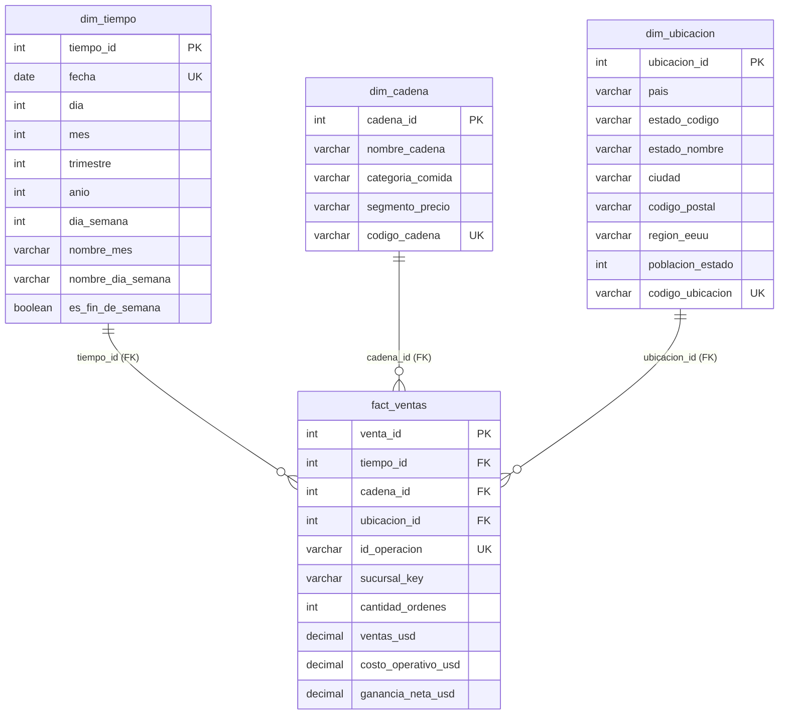

# Trabajo Integrador AE4 — Gestión Avanzada de Bases de Datos
## “Integración de datos y analítica: Desempeño Comercial y Expansión Territorial de Cadenas de Comida Rápida en EE. UU. (2023–2024)”

- **Carrera:** Ingeniería en Sistemas de Información
- **Materia:** Gestión Avanzada de Bases de Datos (2026)
- **Profesores:** Gabriel del Rosario, Portel Marcos, Fernández Victoria
- **Fecha de entrega:** 16/11/2026

---

## 1. Contexto y Definición del Negocio

### 1.1 Contexto Organizacional
El sector gastronómico de servicio rápido (*Quick Service Restaurants* — QSR y *Fast Casual*) en Estados Unidos constituye uno de los mercados más competitivos del comercio minorista, donde coexisten grandes cadenas nacionales con franquicias regionales. Una firma consultora de inversión gastronómica y desarrollo de franquicias necesita evaluar el rendimiento comercial y la huella geográfica de **9.949 sucursales pertenecientes a 468 cadenas** distribuidas en las 4 regiones censales de Estados Unidos durante el período **2023–2024**. El objetivo del análisis es identificar patrones estacionales de demanda, comparar la rentabilidad por categoría gastronómica y detectar estados con alta demanda por local pero baja densidad de sucursales por habitante, con el fin de orientar decisiones de apertura de nuevas franquicias y asignación de presupuesto comercial para el ciclo 2025.

### 1.2 Preguntas de Negocio
Las cuatro preguntas de negocio específicas y verificables que guían el proceso ETL, el diseño del Data Warehouse y el dashboard son:

1. **Pregunta 1 (Eje Temporal — justifica `dim_tiempo`):** ¿Cómo evolucionaron los ingresos trimestrales y el volumen de órdenes entre 2023 y 2024, y qué trimestre concentra el pico estacional de demanda?
2. **Pregunta 2 (Eje Franquicia/Producto — justifica `dim_cadena`):** ¿Qué categorías gastronómicas y segmentos de precio lideran la facturación total acumulada y cuál presenta el mayor ingreso promedio por sucursal activa?
3. **Pregunta 3 (Eje Geográfico/Demográfico — justifica `dim_ubicacion`):** ¿Qué estados y regiones de EE. UU. generan mayor volumen de ventas en relación con su cantidad de sucursales y población (saturación territorial vs. oportunidad de expansión)?
4. **Pregunta 4 (Análisis Multidimensional Integrado — cruza `dim_cadena`, `dim_ubicacion` y `dim_tiempo`):** ¿Cómo varía el ticket promedio por orden y el margen operativo bruto entre las 10 principales cadenas según la región geográfica durante el año 2024?

### 1.3 Indicadores Clave de Desempeño (KPIs)

| Código | Nombre del KPI | Rol | Fórmula Explícita | Unidad de Medida | Valor Global (2023–2024) |
| :--- | :--- | :--- | :--- | :--- | :--- |
| **KPI 1** | **Ingreso Total Acumulado** | **KPI Principal Destacado** | `SUM(ventas_usd)` | Dólares estadounidenses (`USD`) | **$55.439.688.102,71 USD** |
| **KPI 2** | **Ticket Promedio por Orden** | KPI Secundario | `SUM(ventas_usd) / SUM(cantidad_ordenes)` | Dólares por orden (`USD / orden`) | **$12,27 USD/orden** |
| **KPI 3** | **Margen Operativo Bruto** | KPI Secundario | `((SUM(ventas_usd) - SUM(costo_operativo_usd)) / SUM(ventas_usd)) * 100` | Porcentaje (`%`) | **35,53 %** |

### 1.4 Criterios y Supuestos Adoptados
1. **Delimitación geográfica de EE. UU.:** Solo se incluyen sucursales cuyas coordenadas geográficas se encuentren dentro de los límites válidos de Estados Unidos (incluyendo Alaska y Hawái: latitud entre `18°` y `72° N`, y longitud entre `-170°` y `-65° O`). Se excluyen registros mal geocodificados fuera de dicho rango.
2. **Validez contable de operaciones:** Se excluyen del cálculo de indicadores los reportes operativos con montos de venta nulos o negativos (`ventas_usd <= 0`) o sin órdenes (`cantidad_ordenes <= 0`), por tratarse de errores de captura o reversiones contables no operativas.
3. **Imputación de costos operativos faltantes:** Ante registros con `costo_operativo_usd` nulo pero `ventas_usd` válido, se asume la estructura de costos mediana de la categoría gastronómica a la que pertenece la cadena, preservando el volumen de ventas real sin distorsionar el margen sectorial.

### 1.5 Alcance y Limitaciones Iniciales
- **Qué permite responder:** Evolución trimestral y anual de facturación, comparativa de desempeño comercial por cadena, categoría gastronómica, segmento de precio, ciudad, estado y región censal.
- **Qué no se puede responder con las fuentes elegidas:** No es posible analizar la rentabilidad a nivel de producto individual del menú (por ejemplo, hamburguesa específica vs. bebida) ni el comportamiento de recompra por cliente individual, dado que la granularidad de los hechos es el cierre trimestral por sucursal, sin detalle de línea de ticket ni identificador de consumidor.

---

## 2. Descripción de las Fuentes de Datos Utilizadas

El proyecto integra **dos fuentes de datos independientes** que requieren limpieza específica y un cruce relacional (`merge`) mediante clave de sucursal:

### 2.1 Fuente 1 (Real y Externa): Catálogo Geográfico de Sucursales (`FastFoodRestaurants.xlsx` / `.csv`)
- **Origen y autoría:** Dataset público *Datafiniti Fast Food Restaurants Across America* (publicado en Kaggle / Datafiniti Business Database).
- **Enlace de referencia:** `https://www.kaggle.com/datasets/datafiniti/fast-food-restaurants`
- **Licencia:** *CC BY-NC-SA 4.0* (Creative Commons Attribution-NonCommercial-ShareAlike 4.0).
- **Fecha de descarga y preparación:** 03/11/2026 (depuración estructural de columnas realizada el 10/11/2026).
- **Contenido y estructura:** Contiene `10.000` registros de locales de comida rápida en EE. UU. Tras eliminar la columna `J` (`websites`) en adelante y acotar el rango a las filas con datos (`1` a `10001`), conserva las 9 columnas (`A` a `I`): `address`, `city`, `country`, `keys` (identificador compuesto único de la sucursal), `latitude`, `longitude`, `name` (nombre de la cadena), `postalCode` y `province` (código postal de estado de 2 letras).

### 2.2 Fuente 2 (Construida por el Grupo): Reportes Operativos y Demografía Estatal (`operaciones_franquicias_2023_2024.csv`)
- **Naturaleza:** Fuente complementaria construida por el grupo mediante un generador determinístico y reproducible (`etl/generar_fuente_complementaria.py`, semilla `2026`).
- **Por qué era necesaria:** La Fuente 1 es un padrón físico estático de locales (carece de fechas de operación, clasificación gastronómica de las cadenas, regiones censales y métricas monetarias aditivas). Para responder las 4 preguntas de negocio e implementar la dimensión obligatoria `dim_tiempo` junto con métricas aditivas en la tabla de hechos, fue indispensable construir esta segunda fuente transaccional y demográfica.
- **Criterio de construcción:**
  1. Se clasificó cada cadena según su especialidad gastronómica (`Burgers & Grill`, `Tex-Mex`, `Sandwiches & Subs`, `Chicken & Wings`, `Pizza & Italian`, `Coffee, Bakery & Ice Cream`, `Asian & Seafood`, `Otros / Regional`) y su segmento de precio (`Económico (QSR)`, `Fast Casual`, `Estándar`).
  2. Se incorporaron los datos oficiales del **U.S. Census Bureau (2023)** para los 50 estados y Washington D.C.: nombre oficial del estado (`estado_nombre`), región censal (`Northeast`, `Midwest`, `South`, `West`) y población estatal (`poblacion_estado`).
  3. Se generaron 8 cierres trimestrales por sucursal entre 2023 y 2024 (`fecha_reporte` en el último día de cada trimestre: `31/03`, `30/06`, `30/09` y `31/12`, sumando `80.000` reportes base) con las métricas aditivas `cantidad_ordenes`, `ventas_usd` y `costo_operativo_usd`.
  4. Se incluyeron anomalías controladas de captura (`150` duplicados exactos, `120` nulos en `costo_operativo_usd`, `80` nulos en `segmento_precio`, `40` registros con montos negativos y `60` registros con formatos de texto inconsistentes) para validar el proceso de limpieza del ETL.
- **Campo aportado al merge:** `sucursal_key` (que referencia a la columna `keys` de la Fuente 1).

---

## 3. Proceso ETL: Limpieza, Transformación, Merge y Validaciones

El pipeline ETL fue implementado en Python utilizando `pandas` y `SQLAlchemy` (`etl/etl_fastfood_dw.py` y `etl/ETL_COMPLETO_AE4_GABD.ipynb`), estructurado de forma lineal en etapas secuenciales:

### 3.1 Limpieza de la Fuente 1 (`FastFoodRestaurants`)
1. **Reparación de desplazamiento de columnas por comas internas:** Se detectaron `20` filas en el archivo original (ej. filas `52`, `910`, `2641`, `8270`) donde la presencia de comas dentro del campo `address` desplazaba el resto de los atributos hacia las columnas `K` y `L`. El lector (`etl/comun.py`) recompuso el campo `address` y alineó las 9 columnas (`A` a `I`) para los `10.000` registros, quedando `0` nulos iniciales.
2. **Filtrado de valores atípicos geográficos (Outliers de coordenadas):** Al convertir `latitude` y `longitude` a número, se identificaron **`51` registros** cuyas coordenadas caían fuera de Estados Unidos (por ejemplo, locales con direcciones europeas mal geocodificadas en Italia o España con longitud cercana a 0° o +13°). Aplicando el filtro de rango geográfico de EE. UU., la Fuente 1 quedó con **`9.949` sucursales válidas**.
3. **Unificación de cadenas y corrección de estados:** Si dos nombres de cadena coinciden al pasarlos a minúsculas y quitar signos de puntuación (ej. `McDonalds`, `Mcdonald's` → `McDonald's`; `Chick-Fil-A` → `Chick-fil-A`), se unificaron con la escritura más frecuente, reduciendo la dispersión de **`540` a `468` cadenas únicas**. Además, se corrigieron `5` registros de Colorado Springs cuyo estado figuraba como `Co Spgs` → `CO`, y se normalizó `postalCode` a 5 dígitos.

### 3.2 Limpieza de la Fuente 2 (`operaciones_franquicias_2023_2024`)
1. **Eliminación de duplicados:** De las `80.150` filas iniciales, se detectaron y eliminaron **`150` filas duplicadas exactas**, quedando `80.000` operaciones únicas.
2. **Depuración de valores atípicos/negativos:** Se detectaron y descartaron **`40` registros** con valores de `ventas_usd <= 0`, restando `79.960` operaciones válidas.
3. **Tratamiento de valores nulos:**
   - Se imputaron **`80` valores nulos** en `segmento_precio` tomando el segmento de los otros reportes de la misma sucursal (`groupby("sucursal_key").transform("first")`).
   - Se imputaron **`120` valores nulos** en `costo_operativo_usd` aplicando la mediana de la proporción `costo_operativo_usd / ventas_usd` correspondiente a su categoría gastronómica.
4. **Normalización de textos y tipos:** Se limpiaron espacios laterales y capitalización en `categoria_comida` y `region_eeuu`, se convirtió `fecha_reporte` a tipo `DATE` (`YYYY-MM-DD`) y se calculó la métrica derivada `ganancia_neta_usd = ventas_usd - costo_operativo_usd`.

### 3.3 Estrategia de Merge y Validaciones Posteriores al Cruce
- **Clave de cruce:** `sucursal_key` (Fuente 2) = `keys` (Fuente 1), ambas normalizadas en minúsculas y sin espacios laterales.
- **Justificación del tipo de Join (`INNER JOIN` con `validate="many_to_one"`):** De las `79.960` operaciones limpias de la Fuente 2, exactamente **`408` operaciones** pertenecían a las `51` sucursales descartadas en la Fuente 1 por tener coordenadas fuera de EE. UU. ($51 \times 8 = 408$ reportes). Si se utilizara un `LEFT JOIN`, esos 408 hechos quedarían sin ciudad, sin código postal y sin nombre de cadena normalizado. Por lo tanto, el **`INNER JOIN`** garantiza que el 100% de los hechos cargados al Data Warehouse correspondan a sucursales válidas dentro de Estados Unidos.

| Métrica de Validación Post-Merge | Valor Obtenido | Criterio de Aceptación |
| :--- | :---: | :--- |
| Filas limpias en Fuente 1 (Sucursales EE. UU.) | `9.949` | 10.000 − 51 outliers geográficos |
| Filas limpias en Fuente 2 (Operaciones 2023–2024) | `79.960` | 80.150 − 150 dup. − 40 negativos |
| Operaciones sin sucursal válida (excluidas por filtro geo F1) | `408` | 51 sucursales × 8 trimestres |
| **Filas finales en `INNER JOIN` (`df`)** | **`79.552`** | **100% de integridad referencial** |
| **Sucursales únicas integradas** | **`9.949` de `9.949`** | **100% de las sucursales válidas** |
| **Valores nulos introducidos tras el cruce** | **`0`** | Sin pérdida de atributos dimensionales |
| **Duplicados de `id_operacion` post-merge** | **`0`** | Granularidad: 1 fila = 1 cierre trimestral de sucursal |
| **Inconsistencias de estado entre Fuente 1 y Fuente 2** | **`0`** | Coherencia geográfica verificada |

---

## 4. Modelo Dimensional del Data Warehouse en PostgreSQL

Se implementó un **Modelo Estrella (Star Schema)** en la base de datos PostgreSQL `dw_fastfood` compuesto por **4 tablas físicas** (1 tabla de hechos central y 3 tablas de dimensiones), respaldado por los scripts reproducibles `sql/01_creacion_dw.sql` y `sql/02_consultas_analiticas.sql`.

### Justificación de las Dimensiones Elegidas
1. **`dim_tiempo` (`731` filas, generada en SQL para todos los días de 2023 y 2024):** Obligatoria según la consigna; permite agrupar los hechos por `año`, `trimestre` y `mes` para responder la **Pregunta de Negocio 1** sobre evolución interanual y estacionalidad.
2. **`dim_cadena` (`468` filas):** Desnormaliza la jerarquía `nombre_cadena` → `categoria_comida` → `segmento_precio`; es indispensable para responder las **Preguntas de Negocio 2 y 4** sobre liderazgo de facturación y márgenes por franquicia.
3. **`dim_ubicacion` (`5.189` combinaciones postales/ciudades únicas):** Consolida la jerarquía geográfica (`ciudad`, `codigo_postal`, `estado_codigo`, `estado_nombre`, `region_eeuu`) y la población estatal (`poblacion_estado`), permitiendo responder las **Preguntas de Negocio 3 y 4** sobre concentración regional y densidad de sucursales por habitante.

---

## 5. Diccionario de Datos del Data Warehouse (`dw_fastfood`)

### 5.1 Tabla `dim_tiempo` (731 registros)
| Columna | Tipo de Dato SQL | Restricciones | Descripción |
| :--- | :--- | :--- | :--- |
| `tiempo_id` | `SERIAL` | `PRIMARY KEY` | Clave subrogada (SK) de la dimensión tiempo. |
| `fecha` | `DATE` | `UNIQUE NOT NULL` | Fecha calendario completa (`2023-01-01` a `2024-12-31`). |
| `dia` | `INTEGER` | `NOT NULL` | Día del mes (`1` a `31`). |
| `mes` | `INTEGER` | `NOT NULL` | Número de mes (`1` a `12`). |
| `trimestre` | `INTEGER` | `NOT NULL` | Trimestre del año (`1` a `4`). |
| `año` | `INTEGER` | `NOT NULL` | Año calendario (`2023` o `2024`). |
| `dia_semana` | `INTEGER` | `NOT NULL` | Día de la semana según norma ISO (`1`=Lunes a `7`=Domingo). |
| `nombre_mes` | `VARCHAR(20)` | `NOT NULL` | Nombre del mes calendario. |
| `nombre_dia_semana` | `VARCHAR(20)` | `NOT NULL` | Nombre del día de la semana. |
| `es_fin_de_semana` | `BOOLEAN` | `NOT NULL` | Indica `TRUE` si es sábado o domingo (`6` o `7`). |

### 5.2 Tabla `dim_cadena` (468 registros)
| Columna | Tipo de Dato SQL | Restricciones | Descripción |
| :--- | :--- | :--- | :--- |
| `cadena_id` | `SERIAL` | `PRIMARY KEY` | Clave subrogada (SK) de la cadena gastronómica. |
| `nombre_cadena` | `VARCHAR(150)` | `NOT NULL` | Nombre unificado de la franquicia (ej. `McDonald's`). |
| `categoria_comida` | `VARCHAR(100)` | `NOT NULL` | Rubro gastronómico (`Burgers & Grill`, `Tex-Mex`, `Pizza & Italian`, etc.). |
| `segmento_precio` | `VARCHAR(50)` | `NOT NULL` | Posicionamiento comercial (`Económico (QSR)`, `Fast Casual`, `Estándar`). |
| `codigo_cadena` | `VARCHAR(50)` | `UNIQUE NOT NULL` | Clave natural generada en el ETL (`CAD_00001` a `CAD_00468`). |

### 5.3 Tabla `dim_ubicacion` (5.189 registros)
| Columna | Tipo de Dato SQL | Restricciones | Descripción |
| :--- | :--- | :--- | :--- |
| `ubicacion_id` | `SERIAL` | `PRIMARY KEY` | Clave subrogada (SK) de la ubicación geográfica. |
| `pais` | `VARCHAR(50)` | `NOT NULL` | Código ISO del país (`US`). |
| `estado_codigo` | `VARCHAR(10)` | `NOT NULL` | Código postal de 2 letras del estado (`CA`, `TX`, `NY`, etc.). |
| `estado_nombre` | `VARCHAR(100)` | `NOT NULL` | Nombre oficial completo del estado. |
| `ciudad` | `VARCHAR(120)` | `NOT NULL` | Nombre normalizado de la ciudad. |
| `codigo_postal` | `VARCHAR(20)` | `NOT NULL` | Código ZIP de 5 dígitos de la zona postal. |
| `region_eeuu` | `VARCHAR(50)` | `NOT NULL` | Región oficial del Censo de EE. UU. (`West`, `South`, `Midwest`, `Northeast`). |
| `poblacion_estado` | `INTEGER` | `NOT NULL` | Población total del estado según U.S. Census Bureau. |
| `codigo_ubicacion` | `VARCHAR(100)` | `UNIQUE NOT NULL` | Clave natural generada en el ETL (`UBI_00001` a `UBI_05189`). |

### 5.4 Tabla `fact_ventas` (79.552 registros)
| Columna | Tipo de Dato SQL | Restricciones | Descripción |
| :--- | :--- | :--- | :--- |
| `venta_id` | `SERIAL` | `PRIMARY KEY` | Clave subrogada (SK) del registro de hecho. |
| `tiempo_id` | `INTEGER` | `FK -> dim_tiempo` | Referencia a la fecha de cierre trimestral del reporte. |
| `cadena_id` | `INTEGER` | `FK -> dim_cadena` | Referencia a la cadena gastronómica. |
| `ubicacion_id` | `INTEGER` | `FK -> dim_ubicacion` | Referencia a la ubicación geográfica del local. |
| `id_operacion` | `VARCHAR(50)` | `UNIQUE NOT NULL` | Identificador único del reporte (`OP-NNNNNN`). |
| `sucursal_key` | `VARCHAR(180)` | `NOT NULL` | Clave natural de la sucursal física (`keys`). |
| `cantidad_ordenes` | `INTEGER` | `NOT NULL` | **Métrica aditiva:** Cantidad de órdenes despachadas en el trimestre. |
| `ventas_usd` | `DECIMAL(15,2)` | `NOT NULL` | **Métrica aditiva:** Facturación bruta en dólares (`USD`). |
| `costo_operativo_usd` | `DECIMAL(15,2)` | `NOT NULL` | **Métrica aditiva:** Costo operativo total en dólares (`USD`). |
| `ganancia_neta_usd` | `DECIMAL(15,2)` | `NOT NULL` | **Métrica aditiva:** Margen bruto en dólares (`ventas_usd - costo_operativo_usd`). |

---

## 6. Descripción del Dashboard en Power BI

El tablero interactivo desarrollado en **Power BI Desktop** se conecta al modelo estrella de 4 tablas, aplicando transformaciones en **Power Query** (creación de `Periodo_Trimestral` y `Orden_Trimestre`, tipado de códigos postales y monedas) y medidas **DAX** explícitas para los 3 KPIs:

- **Encabezado de KPIs:** Muestra las 3 tarjetas superiores, destacando en mayor tamaño y contraste el **KPI 1 Principal (`Ingreso Total Acumulado: $55.439,69 M USD`)**, acompañado del **KPI 2 (`Ticket Promedio: $12,27 USD/orden`)** y el **KPI 3 (`Margen Operativo Bruto: 35,53%`)**.
- **2 Filtros Interactivos (Segmentadores):** Filtro por **Año (`2023` / `2024`)** y Filtro por **Región de EE. UU. (`South`, `West`, `Midwest`, `Northeast`)**, que recalculan dinámicamente todos los visuales y tarjetas.
- **Correspondencia Visual ↔ Pregunta de Negocio:**
  1. **Visual 1 (Gráfico combinado de Columnas y Líneas):** Titulado con la **Pregunta 1**, muestra la serie trimestral `T1 2023` a `T4 2024` de ingresos totales (columnas) y ticket promedio (línea).
  2. **Visual 2 (Gráfico de Barras Horizontales por Categoría):** Titulado con la **Pregunta 2**, compara la facturación total acumulada y el ingreso promedio por sucursal entre categorías gastronómicas y segmentos de precio.
  3. **Visual 3 (Gráfico de Dispersión / Mapa Geográfico por Estado):** Titulado con la **Pregunta 3**, cruza en el eje X la cantidad de sucursales por estado, en el eje Y las ventas totales en USD y en el tamaño de burbuja las ventas promedio por sucursal, coloreado por `region_eeuu`.
  4. **Visual 4 (Matriz con Formato Condicional):** Titulado con la **Pregunta 4**, cruza las 10 principales cadenas en filas contra las 4 regiones de EE. UU. en columnas, exhibiendo el Ticket Promedio (`USD`) y el Margen Operativo Bruto (`%`).

---

## 7. Hallazgos Analíticos y Recomendación de Negocio

A partir de las consultas analíticas ejecutadas en PostgreSQL (`sql/02_consultas_analiticas.sql`), se obtuvieron los siguientes hallazgos verificables:

1. **Estacionalidad marcada en el 3er Trimestre y crecimiento interanual (+9,66%):**
   - La facturación anual creció de **$26.442,18 M USD en 2023** a **$28.997,51 M USD en 2024** (+9,66%), mientras que el ticket promedio subió de **$12,08 USD** a **$12,45 USD** (+3,06%).
   - El **Trimestre 3 (`T3`, verano boreal: julio–septiembre)** concentra sistemáticamente el pico estacional de demanda en ambos años (**$7.136,90 M USD** en `T3 2023` y **$7.821,16 M USD** en `T3 2024`), superando en **+20,45% (2023)** y **+20,49% (2024)** al trimestre más bajo (`T1`, invierno boreal: **$5.925,22 M USD** en `T1 2023` y **$6.491,37 M USD** en `T1 2024`).
2. **Volumen total vs. Productividad por local según Categoría Gastronómica:**
   - **`Burgers & Grill` en segmento `Económico (QSR)`** domina el volumen absoluto del mercado con `5.249` sucursales (52,8% de los locales) y **$31.712,37 M USD** de facturación (`57,2%` del ingreso total).
   - Sin embargo, al analizar el **ingreso acumulado por sucursal en el bienio**, los formatos **`Fast Casual`** superan ampliamente al QSR tradicional: **`Chicken & Wings (Fast Casual)`** lidera con **$7,50 M USD por sucursal** (*Chick-fil-A*, *Raising Cane's*), seguido por **`Tex-Mex (Fast Casual)`** con **$6,49 M USD por sucursal** (*Chipotle*), frente a los **$4,32 M USD por sucursal** de `Sandwiches & Subs (QSR)`.
   - El mayor margen porcentual lo obtiene **`Coffee, Bakery & Ice Cream`** (**39,07%** de margen bruto) y **`Tex-Mex QSR`** (**37,02%**), gracias a menores costos de insumos cárnicos.
3. **Asimetría geográfica: Saturación en el Midwest vs. Oportunidad en West y Northeast:**
   - Estados del **Midwest** como **Ohio (`OH`)** e **Indiana (`IN`)** presentan una alta saturación relativa con **45,90** y **54,79 sucursales cada millón de habitantes** respectivamente, y un rendimiento por local menor (**$5,17 M USD** y **$5,07 M USD por sucursal**).
   - En contraste, **Nueva York (`NY`, región `Northeast`)** y **California (`CA`, región `West`)** tienen apenas **13,54** y **17,32 sucursales cada millón de habitantes**, pero generan el mayor rendimiento comercial entre los grandes estados: **$6,64 M USD** y **$6,46 M USD por sucursal** (**+28,4%** y **+24,9%** por encima de Ohio). Asimismo, la región **`Northeast`** registra los tickets promedio más altos del país en todas las cadenas líderes con presencia en esa región (ej. *Domino's Pizza* alcanza **$21,55 USD/orden** y *McDonald's* **$13,16 USD/orden** en el Northeast frente a **$11,45 USD** en el Midwest).

### Recomendación Estratégica de Negocio
Con base en los resultados del Data Warehouse (y con la salvedad metodológica de la Limitación 3), se recomienda al directorio del grupo franquiciante:
1. **Priorizar la apertura de nuevas franquicias del formato *Fast Casual* (`Chicken & Wings` y `Tex-Mex`) en las regiones `West` (California, Washington) y `Northeast` (Nueva York, Pensilvania)**, donde la facturación promedio por sucursal ($6,46 M–$7,50 M USD en el bienio) y el ticket promedio superan entre un 15% y un 28% al promedio del `Midwest`, con menos de la mitad de densidad competitiva por habitante.
2. **Detener la expansión de formatos QSR de sándwiches y hamburguesas tradicionales en estados saturados del `Midwest` (como Ohio, Indiana y Misuri)**, redirigiendo el capital hacia promociones estacionales de invierno en **`T1` (enero–marzo)** para atenuar el valle estacional de facturación.

---

## 8. Limitaciones del Trabajo
1. **Granularidad temporal trimestral por sucursal:** No se cuenta con el detalle transaccional hora por hora ni día por día de cada caja registradora, sino con cierres trimestrales por sucursal.
2. **Ausencia de costos de alquiler inmobiliario diferenciados por código postal:** Si bien el modelo contempla costos operativos variables por categoría, no desagrega el costo fijo de arrendamiento por metro cuadrado en cada código ZIP, variable que deberá relevarse antes de confirmar la locación exacta de una nueva apertura en `West` o `Northeast`.
3. **Naturaleza construida de las métricas operativas (Fuente 2):** Las métricas monetarias (`ventas_usd`, `cantidad_ordenes`, `costo_operativo_usd`) y las fechas provienen de la fuente complementaria construida por el grupo según lo habilitado en el punto 3.2 de la consigna, no de estados contables reales de las cadenas. Lo que sí es 100% real y externo es la Fuente 1 (ubicación, cadena y cantidad de sucursales por estado) y la población estatal oficial del *U.S. Census Bureau*, por lo que los indicadores de densidad competitiva (`sucursales_por_millon_hab`) reflejan fielmente el dataset original.
